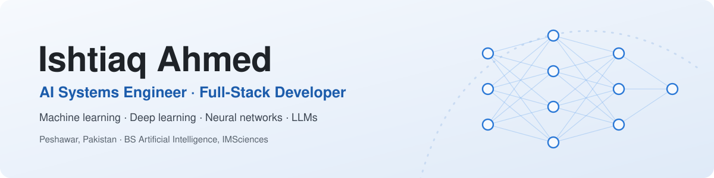
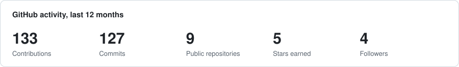
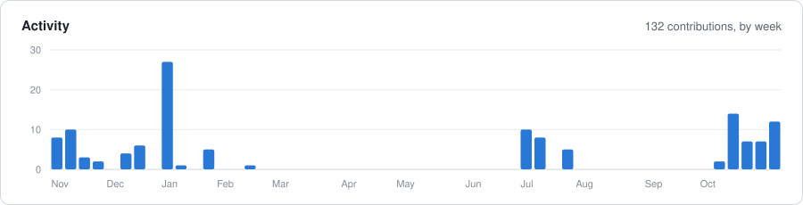
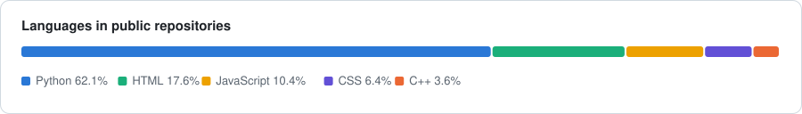

<picture>
  <source media="(prefers-color-scheme: dark)" srcset="assets/header-dark.svg">
  
</picture>

  
  
  
  
  

## About me

I build AI systems that hold up outside the notebook: models that are measured honestly, and software around them that runs in production.

- **Neural control:** trained a neural network that flies an entire Falcon 9-class launch and booster landing, every command from liftoff to touchdown, across 10,056 randomised test missions.
- **Biomedical AI:** first author of **CardioFusion-SSL**, a self-supervised model that fuses ECG and heart-sound signals for cardiac screening (AUROC 0.985 under subject-disjoint validation).
- **Production software:** client portals and automations for international clients: multi-tenant React and FastAPI portals, self-hosted n8n WhatsApp workflows, real-time voice AI backends on Azure.
- **Agents and voice:** local-first assistants on Ollama with ChromaDB retrieval and tool use; speaker verification and anti-spoofing face recognition.
- Studying for a **BS in Artificial Intelligence** at IMSciences, Peshawar.

## Featured project

<table>
<tr>
<td width="56%">

</td>
<td>

### [Rocket Mission Lab](https://github.com/ishtiaq-ahmed-dev/rocket-mission-lab)

A Falcon 9-class launch and return-to-launch-site landing, **flown end to end by a neural network** in the browser. Physics, network and renderer run in one page, with no scripted guidance.

- **1,300 / 1,300** held-out missions completed
- Recovers from forced engine faults in **399 / 400** flights
- Trained by imitation of a predictive teacher with DAgger

`Three.js` `PyTorch` `Node.js` `Imitation learning`

</td>
</tr>
</table>

## More projects

<table>
<tr>
<td width="50%" valign="top">

### [CardioFusion-SSL](https://github.com/ishtiaq-ahmed-dev/CardioFusion-SSL)
Cross-modal self-supervised pretraining and hierarchical fusion of 12-lead ECG and heart-sound (PCG) signals for cardiac screening. Accepts paired, ECG-only or PCG-only input; validated subject-disjoint and on ten external datasets.

**AUROC 0.985 · sensitivity 0.953** (10-fold, subject-disjoint)

`PyTorch` `Contrastive learning` `Biomedical signals`

</td>
<td width="50%" valign="top">

### [FaceGuard AI](https://github.com/ishtiaq-ahmed-dev/faceguard-ai)
Face verification that checks the person is present, not just that the face matches: three independent liveness signals (motion, texture, depth) over a face recogniser, refusing rather than degrading when a check cannot run.

**Anti-spoofing against photo and screen replay attacks**

`Python` `Computer vision` `Security`

</td>
</tr>
<tr>
<td width="50%" valign="top">

### [Robust Voice Recognition](https://github.com/ishtiaq-ahmed-dev/robust-voice-recognition)
Speaker enrolment, identification and verification on GE2E voice embeddings, with voice-activity detection, calibrated confidence, speaker-disjoint evaluation, a FastAPI service and a live dashboard.

**Noise-robust inference with confidence-scored predictions**

`Python` `FastAPI` `Speech`

</td>
<td width="50%" valign="top">

### ISHTI (private)
A personal, local-first AI assistant: voice in and out, retrieval over personal notes with ChromaDB, and tool-driven agents running on local models through Ollama.

**Runs locally, no cloud dependency**

`Python` `Ollama` `RAG` `Agents`

</td>
</tr>
</table>

Also: C++ data structures and object-oriented programming practice in [DATA_STRUCTURES](https://github.com/ishtiaq-ahmed-dev/DATA_STRUCTURES) and [Cpp-Library](https://github.com/ishtiaq-ahmed-dev/Cpp-Library).

## Professional work

| Project | What I built | Link |
| --- | --- | --- |
| **Startup Consultancy client portal** | Multi-tenant compliance portal for international entrepreneurs (React, FastAPI) | [portal.startupconsultancyofficial.com](https://portal.startupconsultancyofficial.com/) |
| **WhatsApp automation CRM** | Self-hosted n8n workflows for client messaging and follow-up | [startupconsultancyofficial.com](https://startupconsultancyofficial.com/) |
| **JQ AI Solutions** | Company platform and AI services website | [jqaisolutions.com](https://jqaisolutions.com/) |
| **Muslim 360** | Android app, published on Google Play | [Google Play](https://play.google.com/store/apps/details?id=com.foxentech.muslim) |

## Tech stack

| Area | Tools |
| --- | --- |
| **AI and ML** |        |
| **Backend and cloud** |         |
| **Frontend** |     |
| **Automation and tools** |     |

## GitHub at a glance

<picture>
  <source media="(prefers-color-scheme: dark)" srcset="assets/stats-dark.svg">
  
</picture>
<picture>
  <source media="(prefers-color-scheme: dark)" srcset="assets/activity-dark.svg">
  
</picture>
<picture>
  <source media="(prefers-color-scheme: dark)" srcset="assets/languages-dark.svg">
  
</picture>

Generated from the GitHub API by <a href="scripts/profile_stats.py">scripts/profile_stats.py</a> and refreshed daily.

---

   
  © 2026 Ishtiaq Ahmed

